<div align="center">

# 🎓 PlacementX

### Campus Placement Automation Platform

*Digitizing the entire campus placement lifecycle — from student profiles to offer letters.*

Built as a capstone project for **NMIMS University**

<br/>


<br/>

[**Features**](#-features) ·
[**Architecture**](#-architecture) ·
[**Workflows**](#-workflows) ·
[**Data Model**](#-data-model) ·
[**Getting Started**](#-getting-started) ·
[**Deployment**](#-deployment) ·
[**Status**](#-project-status)

</div>

---

## 📑 Table of Contents

- [Overview](#-overview)
- [Features](#-features)
- [User Roles](#-user-roles)
- [Tech Stack](#-tech-stack)
- [Architecture](#-architecture)
- [Workflows](#-workflows)
- [Data Model](#-data-model)
- [Repository Structure](#-repository-structure)
- [Getting Started](#-getting-started)
- [Environment Variables](#-environment-variables)
- [Scripts](#-scripts)
- [API Overview](#-api-overview)
- [Business Rules](#-business-rules)
- [Deployment](#-deployment)
- [Project Status](#-project-status)
- [Known Limitations](#-known-limitations)
- [Contributing](#-contributing)

---

## 🌟 Overview

Campus placements at NMIMS were run on spreadsheets, email threads, and WhatsApp groups. **PlacementX** replaces that with one unified platform for the **Training & Placement Office (TPO)**, **students**, **coordinators**, and **recruiters**, on both web and mobile.

<table>
<tr>
<td width="25%" align="center">

### 🧑‍🎓 Students
Build profiles, discover eligible drives, apply, and track every application.

</td>
<td width="25%" align="center">

### 🏛️ Placement Cell
Run drives, verify students, import data, and watch live analytics.

</td>
<td width="25%" align="center">

### 🧑‍🏫 Coordinators
Manage students and verifications within their own department.

</td>
<td width="25%" align="center">

### 🤝 Recruiters
Submit drive details through a secure link, with no account needed.

</td>
</tr>
</table>

### The placement lifecycle at a glance

```mermaid
flowchart LR
    A["📥 Import<br/>students"] --> B["👤 Profile<br/>& verify"]
    B --> C["🏢 Create<br/>drive"]
    C --> D["✅ Eligibility<br/>check"]
    D --> E["📝 Apply"]
    E --> F["🎯 Selection<br/>rounds"]
    F --> G["📄 Offer<br/>letters"]
    G --> H["📊 Analytics<br/>& reports"]

    style A fill:#e0f2fe,stroke:#0284c7,color:#0c4a6e
    style B fill:#e0f2fe,stroke:#0284c7,color:#0c4a6e
    style C fill:#fef3c7,stroke:#d97706,color:#78350f
    style D fill:#fef3c7,stroke:#d97706,color:#78350f
    style E fill:#dcfce7,stroke:#16a34a,color:#14532d
    style F fill:#dcfce7,stroke:#16a34a,color:#14532d
    style G fill:#fce7f3,stroke:#db2777,color:#831843
    style H fill:#fce7f3,stroke:#db2777,color:#831843
```

> **⚠️ Status:** Single-college production pilot. Web is live on Vercel and the API on Render. Mobile source is complete and bundle-verified, but APK/device QA is pending. See [Project Status](#-project-status) and [Known Limitations](#-known-limitations).

---

## ✨ Features

| | Area | Highlights |
|---|------|-----------|
| 🧑‍🎓 | **Student portal** | Unified login · multi-step profile · semester-wise marks · separate 10th/12th/Degree PDF uploads · drive discovery · application tracking · interview calendar · 13-panel settings |
| 🏛️ | **Placement cell** | Drive wizard · eligibility engine · Excel/CSV bulk import · account provisioning · profile verification · update-request review · calendar · notification broadcasts |
| 📊 | **Analytics & reports** | Placement overview · department breakdown · year-over-year comparison · package analysis · company stats · application funnel · exportable Excel reports |
| 🤝 | **HR portal** | Token-based wizard · auto-saved drafts · approve / reject / request-changes workflow · public recruiter event view |
| 🔔 | **Notifications** | In-app · Firebase push (FCM) · Socket.io real-time · BullMQ queue · templates · scheduling |
| 🔐 | **Security** | Database-owned roles · 15-min JWTs · OTP password reset (HMAC, timing-safe) · rate limiting · private report storage |
| 🎨 | **Experience** | Light/dark theme · compact mode · responsive layouts · global loader · reduced-motion support |
| 🩺 | **Operations** | `/health` and `/health/ready` probes · graceful shutdown · CI with Prisma generation |

<details>
<summary><b>🧑‍🎓 Student settings — all 13 panels</b></summary>

<br/>

| Panel | Panel | Panel |
|-------|-------|-------|
| Account | Profile Preferences | Notifications |
| Security | Application Preferences | Calendar |
| Regional | Connected Devices | Privacy |
| Appearance | Danger Zone | Help & Support |

</details>

<details>
<summary><b>🚫 Removed features</b></summary>

<br/>

The earlier AI/ML features (success prediction, placement forecasting, resume parsing, embeddings, AI admin analytics) and the Python `ml-service` were **removed** to streamline the architecture.

</details>

---

## 👥 User Roles

| Role | Authentication | Access scope |
|------|----------------|--------------|
| 🧑‍🎓 **STUDENT** | Firebase credential → API JWT | `/student/*` |
| 🏛️ **SUPER_ADMIN** | Firebase credential → API JWT | `/admin/*` (institution-wide) |
| 🧑‍🏫 **COORDINATOR** | Firebase credential → API JWT | Limited `/admin/*` (own department) |
| 🤝 **HR / Recruiter** | Invitation token (no account) | `/hr-drive/:token` |
| 👤 **Guest** | None | `/login` and public pages |

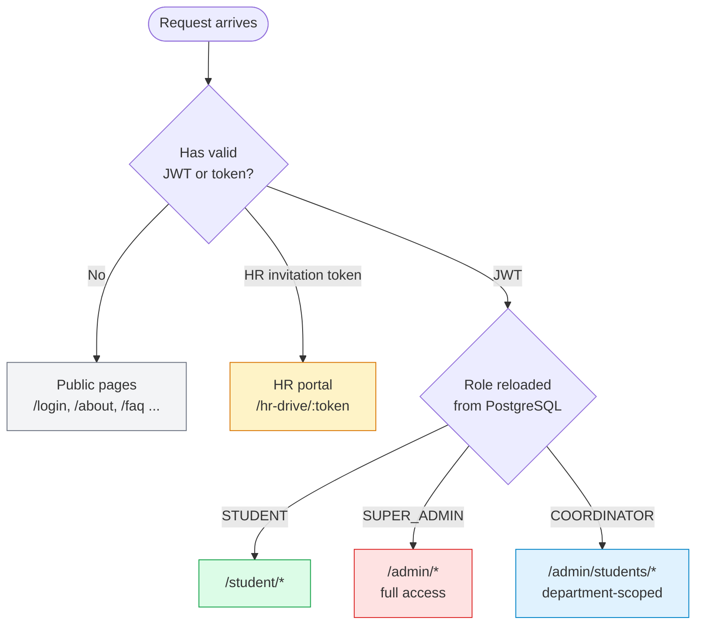

<details>
<summary><b>Permission matrix</b></summary>

<br/>

| Capability | Student | Coordinator | Super Admin | HR |
|------------|:------:|:-----------:|:-----------:|:--:|
| Own profile and applications | ✅ | ❌ | ❌ | ❌ |
| Apply to drives | ✅ | ❌ | ❌ | ❌ |
| Manage students (own department) | ❌ | ✅ | ✅ | ❌ |
| Verify profiles / update requests | ❌ | ✅ | ✅ | ❌ |
| Drive administration | ❌ | ❌ | ✅ | ❌ |
| Bulk import and provisioning | ❌ | ❌ | ✅ | ❌ |
| Analytics and reports | ❌ | ❌ | ✅ | ❌ |
| Broadcasts and calendar | ❌ | ❌ | ✅ | ❌ |
| Coordinator management and settings | ❌ | ❌ | ✅ | ❌ |
| Submit drive details via link | ❌ | ❌ | ❌ | ✅ |

</details>

---

## 🧰 Tech Stack

<table>
<tr>
<td valign="top" width="33%">

### 🌐 Web
`apps/web`

- React 18 + TypeScript
- Vite
- Tailwind CSS v4
- shadcn/ui
- Zustand
- TanStack Query
- React Router v7
- React Hook Form + Zod
- Recharts · FullCalendar
- Framer Motion
- Socket.io Client
- Firebase SDK

</td>
<td valign="top" width="33%">

### 📱 Mobile
`apps/mobile`

- React Native (Expo 54)
- TypeScript
- React Navigation
- Zustand
- TanStack Query
- expo-notifications
- expo-secure-store
- Socket.io Client
- Firebase SDK

</td>
<td valign="top" width="33%">

### ⚙️ API
`apps/api`

- Node.js ≥ 20 + Express
- TypeScript
- Prisma + PostgreSQL
- Firebase Admin
- JWT
- BullMQ + Redis
- Socket.io
- Zod · ExcelJS
- Nodemailer (SMTP / Brevo)
- Supabase Storage

</td>
</tr>
</table>

**Infrastructure:** Vercel · Render (Singapore) · Supabase · Firebase · Brevo · GitHub Actions · Docker Compose (local PostgreSQL)

---

## 🏗️ Architecture

### System architecture

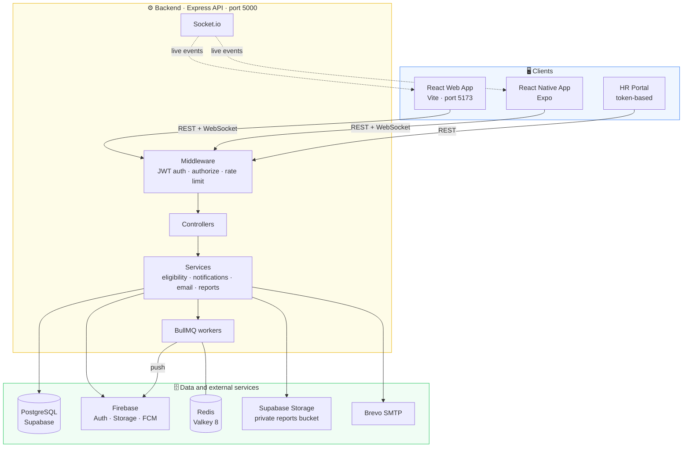

The API follows a layered pattern:

```
Routes → Middleware (Auth + Authorization) → Controllers → Services → Prisma → PostgreSQL
```

### Request data flow

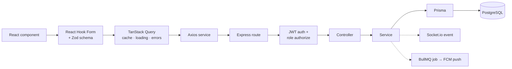

### Authentication

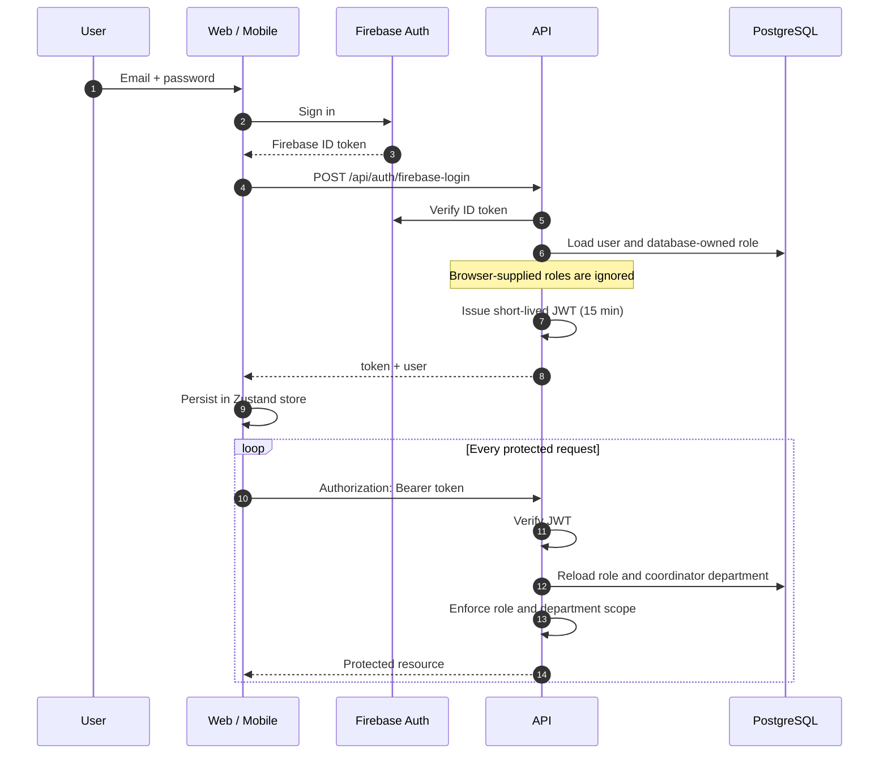

Login **fails closed**: if verification fails, there is no offline or client-selected role fallback. Demo accounts in `DEMO_EMAIL_ALLOWLIST` may sign in without Firebase email verification.

### Notification pipeline

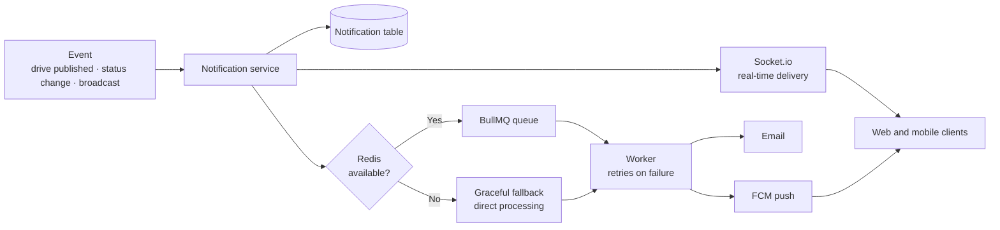

---

## 🔄 Workflows

### Student onboarding

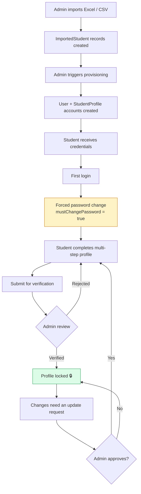

### Profile status

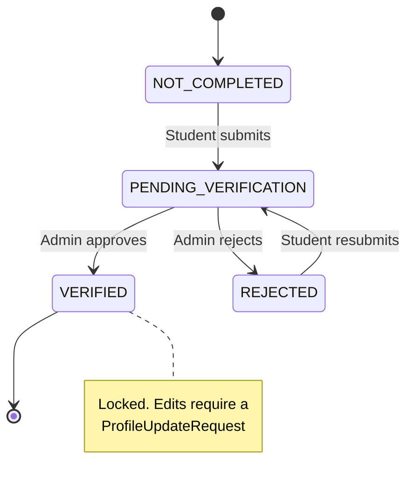

### Placement drive lifecycle

Drives can be created directly by the admin (**Method A**) or collaboratively with HR (**Method B**).

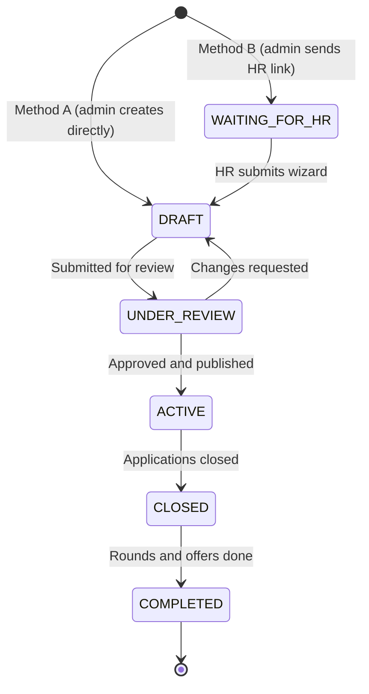

### HR collaboration

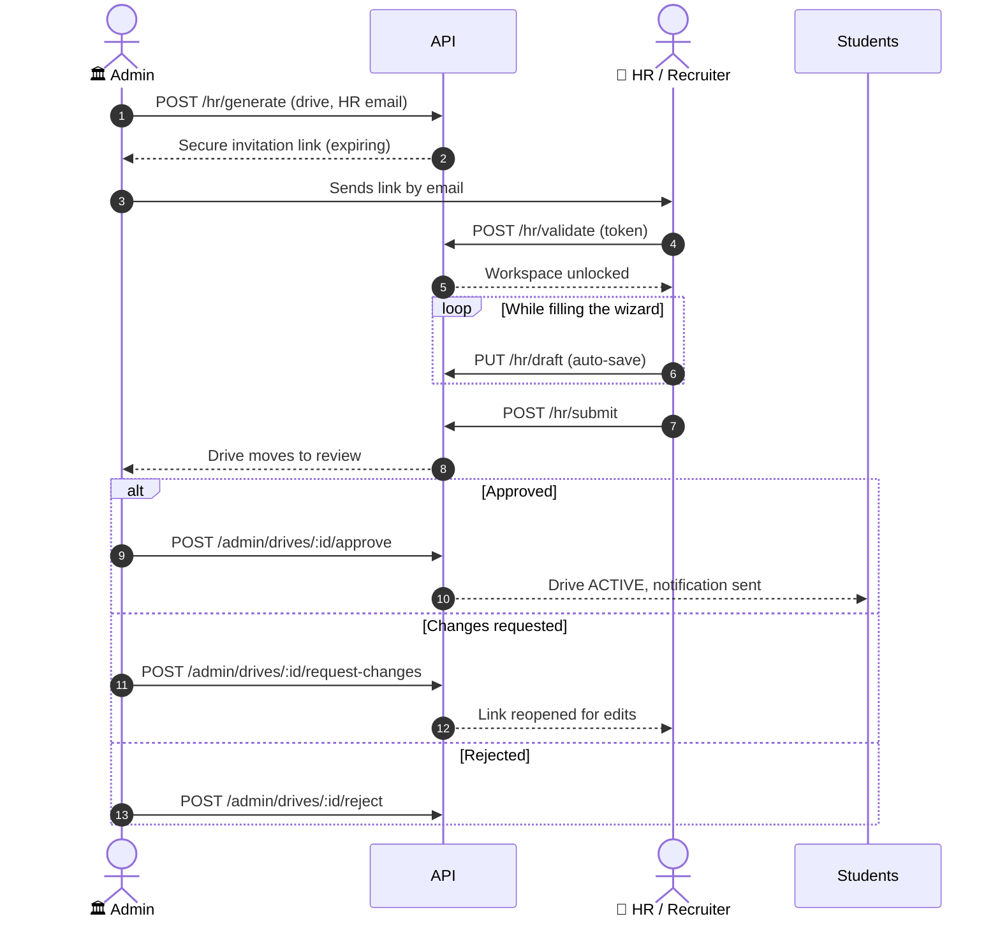

HR links carry an `expiresAt` timestamp, and expiry is enforced in **every** drive state, even after publication.

### Student application

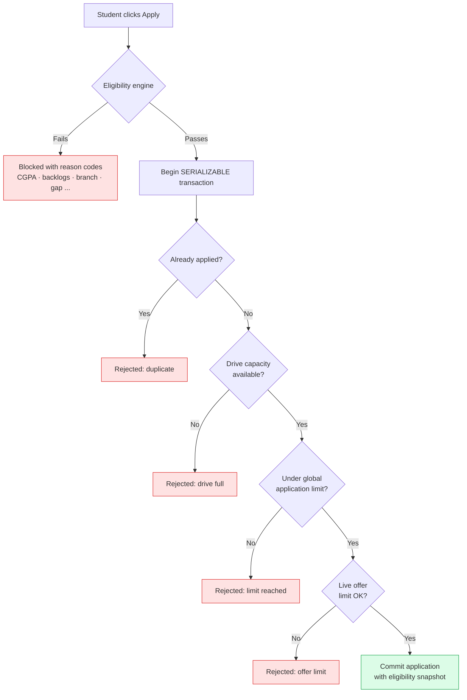

### Application status

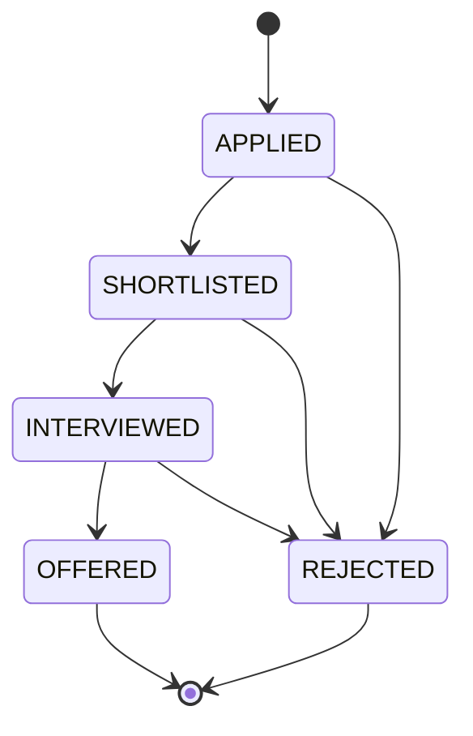

### OTP password reset

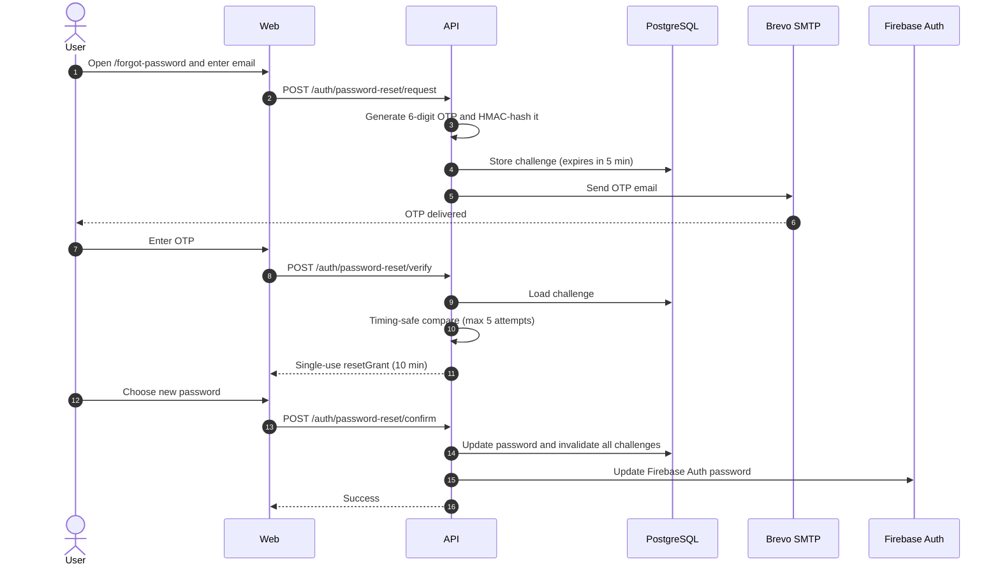

| Safeguard | Value |
|-----------|-------|
| OTP lifetime | 5 minutes |
| Reset grant lifetime | 10 minutes, single use |
| Resend cooldown | 60 seconds |
| Max failed attempts | 5 per challenge |
| Storage | HMAC-SHA-256 hash with `PASSWORD_RESET_SECRET` |
| Comparison | Constant-time |

---

## 🗄️ Data Model

Schema source of truth: [`apps/api/prisma/schema.prisma`](apps/api/prisma/schema.prisma)

### Core entities

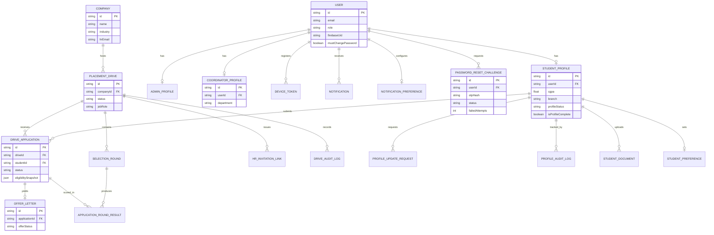

> `DriveApplication` has a unique constraint on `(driveId, studentId)`, so a student can apply to a drive only once.

<details>
<summary><b>📚 Full entity catalogue</b></summary>

<br/>

| Group | Entities |
|-------|----------|
| **Accounts** | `User`, `AdminProfile`, `CoordinatorProfile`, `StudentProfile`, `AccountActivationToken`, `PasswordResetChallenge` |
| **Drives** | `Company`, `PlacementDrive`, `SelectionRound`, `DriveApplication`, `ApplicationRoundResult`, `OfferLetter`, `DriveAuditLog`, `HrInvitationLink` |
| **Policy & eligibility** | `PlacementPolicyVersion`, `EligibilityEvaluation`, `AttendanceExceptionReview` |
| **Student data** | `ImportedStudent`, `StudentDocument`, `StudentPreference`, `ProfileUpdateRequest`, `ProfileAuditLog` |
| **Notifications** | `Notification`, `NotificationCampaign`, `NotificationTemplate`, `NotificationPreference`, `DeviceToken` |
| **Reports** | `ReportTemplate`, `ReportExportHistory`, `ScheduledReport` |
| **Configuration** | `SystemSetting`, `SettingAuditLog`, `AcademicYear`, `Semester`, `CustomCalendarEvent` |

</details>

---

## 📁 Repository Structure

```
PlacementX/
├── apps/
│   ├── api/                  ⚙️  Express + Prisma backend
│   │   ├── prisma/           │   schema.prisma + migrations
│   │   └── src/              │   config · controllers · middlewares · routes
│   │                         │   services · socket · utils
│   ├── web/                  🌐  React (Vite) web app
│   │   └── src/features/     │   admin · auth · hr-portal · notifications · public · student
│   └── mobile/               📱  React Native (Expo) app
├── packages/                 📦  Shared workspace packages
│                                 types · ui · utils · validation · firebase · config ...
├── Student_data/             📊  Excel files for student import
├── docs/                     📚  Audits, deployment notes, mobile docs
├── docker-compose.yml        🐳  Local PostgreSQL
├── .env.example              🔑  Environment template
├── ARCHITECTURE.md           🏗️  System architecture notes
└── package.json              npm workspaces root
```

<details>
<summary><b>⚠️ Files to modify with care</b></summary>

<br/>

| File | Why |
|------|-----|
| `apps/api/prisma/schema.prisma` | Database source of truth; changes need a migration |
| `apps/web/src/routes/index.tsx` | Central routing; route changes require guard updates |
| `apps/web/src/stores/authStore.ts` | Auth state used by every protected route |
| `apps/api/src/middlewares/auth.middleware.ts` | JWT verification; changes affect all protected endpoints |
| `packages/types/` | Shared by web and mobile |

</details>

---

## 🚀 Getting Started

### Prerequisites

| Requirement | Notes |
|-------------|-------|
| Node.js ≥ 20, npm ≥ 10 | Required |
| Firebase project | Auth, Storage, and FCM enabled |
| Supabase project | Or a local PostgreSQL instance |
| Docker | Optional, for local PostgreSQL |
| Redis | Optional locally, required for production queues |

### Setup flow

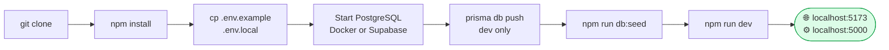

### Commands

```bash
# 1. Clone and install
git clone <repository-url>
cd PlacementX
npm install

# 2. Configure environment (fill in Firebase, Supabase, JWT, password-reset secrets)
cp .env.example .env.local

# 3. Database
docker-compose up -d            # Option A: local PostgreSQL
                                # Option B: set DATABASE_URL / DIRECT_URL for Supabase
cd apps/api
npx prisma db push              # disposable dev databases only
npm run db:seed                 # seeds an admin and a test student
cd ../..

# 4. Run API (5000) + Web (5173)
npm run dev
```

```bash
# Run apps individually
npm run dev --workspace=@placementx/api
npm run dev --workspace=@placementx/web

# Mobile (Expo)
cd apps/mobile && npm start
```

> On Windows use `run.bat`; on Unix use `run.sh`.
>
> 🔑 Seed credentials live in `apps/api/src/seed.ts` and `login_credentials.md`. They are for **local development only**. Never use them in production. For persistent or deployed databases, use committed migrations (`npm run db:migrate:deploy`) instead of `db push`.

---

## 🔐 Environment Variables

Copy `.env.example` to `.env.local` (gitignored). **Never commit real secrets.**

| Group | Variables |
|-------|-----------|
| 🗄️ **Database** | `DATABASE_URL` · `DIRECT_URL` |
| 🔥 **Firebase (client)** | `VITE_FIREBASE_API_KEY` · `VITE_FIREBASE_AUTH_DOMAIN` · `VITE_FIREBASE_PROJECT_ID` · `VITE_FIREBASE_STORAGE_BUCKET` · `VITE_FIREBASE_MESSAGING_SENDER_ID` · `VITE_FIREBASE_APP_ID` |
| 🔥 **Firebase (server)** | `FIREBASE_WEB_API_KEY` · `FIREBASE_DATABASE_URL` |
| 🔑 **Auth** | `JWT_SECRET` · `JWT_ACCESS_EXPIRES_IN` (default `15m`) · `JWT_ISSUER` · `JWT_AUDIENCE` · `PASSWORD_RESET_SECRET` (≥ 32 chars) |
| ✉️ **Email** | `SMTP_HOST` · `SMTP_PORT` · `SMTP_USER` · `SMTP_PASSWORD` · `EMAIL_FROM` · `EMAIL_FROM_NAME` |
| 📮 **Queues** | `REDIS_URL` · `REDIS_REQUIRED` (default `false`) |
| 🪣 **Storage** | `SUPABASE_SERVICE_ROLE_KEY` · `SUPABASE_STORAGE_BUCKET` · `SUPABASE_REPORTS_BUCKET` |
| 🛡️ **Access control** | `DEMO_EMAIL_ALLOWLIST` · `OFFICIAL_STUDENT_EMAIL_DOMAINS` · `CORS_ORIGINS` · `TRUST_PROXY` |
| 🚦 **Rate limiting** | `AUTH_RATE_LIMIT_WINDOW_MS` (default 15 min) · `AUTH_RATE_LIMIT_MAX` (default 10) |
| 🌍 **General** | `FRONTEND_URL` · `PORT` (default `5000`) |

Standalone mobile builds require an explicit `EXPO_PUBLIC_API_URL`.

---

## 🛠️ Scripts

| Command | Scope | Description |
|---------|-------|-------------|
| `npm run dev` | Root | Start API and web together |
| `npm run build` | Root | Build all workspaces |
| `npm run lint` | Root | Lint all workspaces |
| `npm run type-check` | Root | TypeScript checks |
| `npm run format` / `format:check` | Root | Prettier |
| `npm run seed` | Root | Seed the database |
| `npm run db:push` | `apps/api` | Dev-only schema sync |
| `npm run db:migrate:deploy` | `apps/api` | Apply committed migrations |
| `npm run db:migrate:status` | `apps/api` | Inspect migration state |
| `npm run db:studio` | `apps/api` | Prisma Studio |
| `npm run db:seed` | `apps/api` | Seed the database |

---

## 🔌 API Overview

**Base URL:** `http://localhost:5000/api` · **Auth:** `Authorization: Bearer <JWT>`

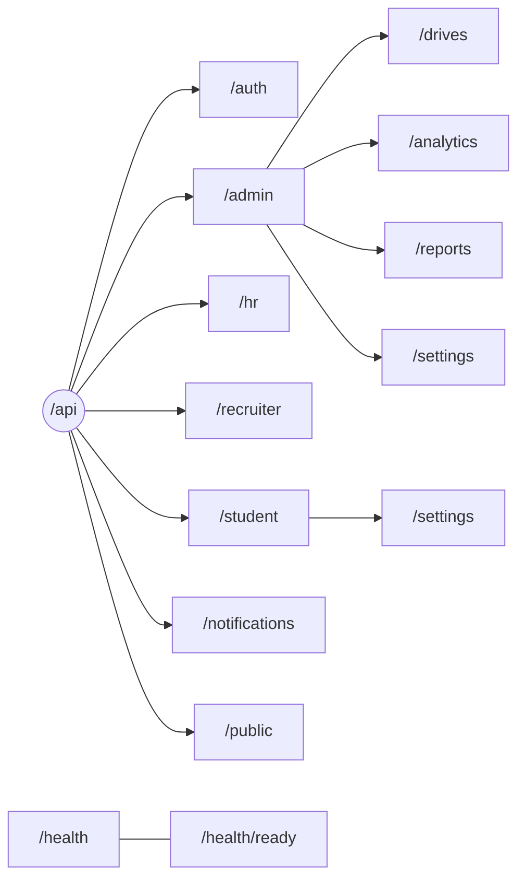

| Prefix | Description | Auth |
|--------|-------------|------|
| `/api/auth` | Login, register, Firebase login, change password, current user, OTP password reset | Mixed |
| `/api/admin` | Dashboard, students, coordinators, calendar, import, provisioning, verifications, update requests | Admin |
| `/api/admin/drives` | Drive CRUD, applications, HR drive review | Mixed |
| `/api/admin/analytics` | Placement stats and insights | Admin |
| `/api/admin/reports` | Report generation, download, history | Admin |
| `/api/admin/settings` | System settings | Admin |
| `/api/hr` | Link generation, validation, drafts, submission | Admin / token |
| `/api/recruiter` | Event view, shortlisting, interviews | Token |
| `/api/student` | Profile, applications, interviews, documents | Student |
| `/api/student/settings` | Preferences, privacy, devices, support, deactivation, data export | Student |
| `/api/notifications` | Notifications, preferences, devices, broadcast, scheduling | JWT |
| `/api/public` | Public placement stats | None |
| `/health` · `/health/ready` | Liveness and readiness probes | None |

<details>
<summary><b>Health endpoints</b></summary>

<br/>

| Endpoint | Success | Failure | Checks |
|----------|---------|---------|--------|
| `GET /health` | `200 {"status":"ok"}` | n/a | Express process only |
| `GET /health/ready` | `200 {"status":"ready"}` | `503 {"status":"not_ready"}` | Redis PING with a 2 s timeout |

Neither endpoint exposes credentials, internal addresses, or stack traces.

</details>

---

## 📜 Business Rules

> These rules must not be broken accidentally during development.

| # | Rule | Detail |
|---|------|--------|
| 1 | 🔒 **Profile lock** | Verified profiles are read-only; changes go through a `ProfileUpdateRequest` |
| 2 | ✅ **Eligibility** | Min CGPA · allowed branches · current and total backlogs · year gap · semester · passing year · gender · required resume/portfolio/GitHub/LinkedIn |
| 3 | 1️⃣ **Unique application** | One application per student per drive |
| 4 | ⚛️ **Safe concurrency** | Applications use a serializable transaction (duplicate, capacity, limit, and offer rechecks) |
| 5 | 🔑 **Forced password change** | Provisioned accounts must change password on first login |
| 6 | ⏳ **HR link expiry** | Enforced in every drive state |
| 7 | 🛡️ **Role access** | `SUPER_ADMIN` is institution-wide; `COORDINATOR` is department-scoped |
| 8 | 🎯 **Offer limits** | Multiple offers disallowed; applications per student capped (default 5) via settings |

---

## ☁️ Deployment

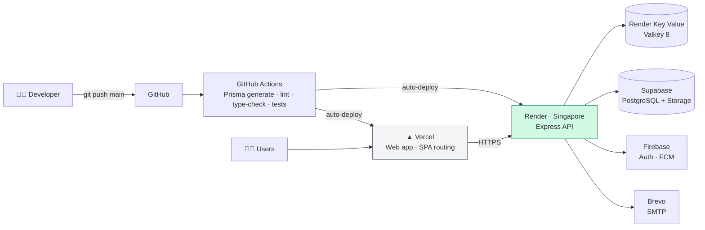

| Service | Platform | Notes |
|---------|----------|-------|
| 🌐 Web | Vercel | `apps/web/vercel.json` SPA routing, auto-deploys from `main` |
| ⚙️ API | Render (Singapore) | Free tier, auto-deploys from `main` |
| 📮 Redis | Render Key Value | Valkey 8, private network |
| 🗄️ Database | Supabase | PostgreSQL via Prisma |
| 🔥 Auth / FCM | Firebase | Google Cloud |
| ✉️ Email | Brevo | SMTP via Nodemailer |

### Release checklist

- [ ] Provision PostgreSQL/Supabase, Redis, Firebase, and API/web runtimes
- [ ] Create a **private** Supabase bucket named `generated-reports`
- [ ] Set production secrets: `JWT_SECRET`, `PASSWORD_RESET_SECRET`, Firebase Admin credentials, Redis, Supabase, SMTP
- [ ] New database: run `npm run db:migrate:deploy`
- [ ] Existing `db push` database: back up, verify it matches the baseline, then mark `20260919000000_baseline` as applied with `prisma migrate resolve`. **Never run the baseline SQL on a populated database.**
- [ ] Verify `/health` and `/health/ready`
- [ ] Run production builds, tests, and live end-to-end checks before admitting users

> 💤 Render's free tier sleeps after 15 minutes of inactivity (30–60 s cold start). See `docs/RENDER_FREE_TIER_KEEPALIVE.md`.

---

## 📈 Project Status

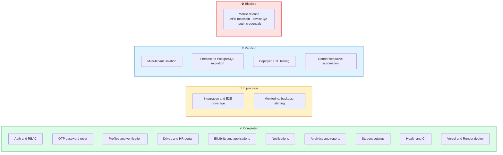

| Area | Status |
|------|:------:|
| Web application | ✅ Deployed |
| API | ✅ Deployed |
| Password reset and email | ✅ Operational |
| Health monitoring | ✅ Live |
| Automated tests | 🟡 8 API test files, E2E expanding |
| Mobile app | ⚠️ Source and bundle verified, APK blocked |
| Multi-tenancy | ❌ Not started |

---

## ⚠️ Known Limitations

| Issue | Severity | Notes |
|-------|:--------:|-------|
| **No multi-tenant isolation** | 🔴 Critical for SaaS | Single-college design. Tenant scoping is needed across DB, storage, queues, and Socket.io before serving multiple colleges |
| **Mobile release incomplete** | 🟠 High | Source, TypeScript, contract tests, and Android export pass; no APK or device-install claim is made |
| **Render cold starts** | 🟡 Medium | 30–60 s first request after idle on the free tier |
| **Large Excel chunk** | 🟡 Medium | ~949 KB in the web build; load spreadsheet features on demand |
| **Limited test coverage** | 🟡 Medium | Broader auth, authorization, import, report, and E2E coverage needed |
| **Dual Firebase / PostgreSQL** | 🟡 Medium | Firebase remains for Auth/FCM while PostgreSQL holds app data |
| **SMTP dependency** | 🟢 Low | Production password reset depends on Brevo availability |

---

## 🤝 Contributing

**Before changing code**

1. Read `project_context.md` and `ARCHITECTURE.md`
2. Check `apps/api/prisma/schema.prisma` before any database change
3. Follow the controller → service → Prisma pattern and the feature-based layout in `apps/web/src/features/`
4. Use Prisma for data access, Zod for validation, TanStack Query for fetching, and shadcn/ui for components

**After changing code**

```bash
npm run type-check
npm run lint
```

If the Prisma schema changed, create and review a migration (use `db:push` only on disposable databases), then update `project_context.md` and its change log.

---

## 📄 License

Built as a capstone project for NMIMS University. Add license terms here if the repository is made public.

<div align="center">

<br/>

**PlacementX** · Made for NMIMS University 🎓

</div>
